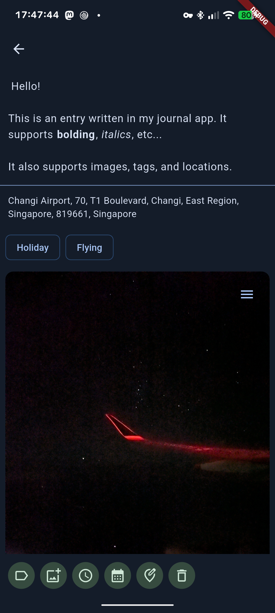

# Journaling Suite
An Android journalling app, and a self-hostable journalling website that use the same format. 

## Features
 - Images
 - Tags
 - Location data
 - Markdown editor

## Android
The markdown files are stored where you want them using SAF, and the yaml frontmatter is (mostly) comptible with Obsidian. The app uses Flutter, but has no iOS support. 

### Installation
To install, get the latest release off the [releases page](https://github.com/owen-59/journal/releases) or [on Obtainium](https://apps.obtainium.imranr.dev/redirect?r=obtainium://app/%7B%0A%20%20%22id%22:%20%22com%2Eowen59%2Ejournal%22,%0A%20%20%22url%22:%20%22https://github%2Ecom/owen%2D59/journal%22,%0A%20%20%22author%22:%20%22owen%2D59%22,%0A%20%20%22name%22:%20%22Journal%22%0A%7D%0A).

### Gallery

  
   
  

## Web
Currently, run the web version is not fully developed, and has no authentication, so do not expose it publically. The website also has to run on the same machine that you are editing the entries with.

### Installation
Clone the repository with `git`, install `pnpm` and `flutter`. In the `web-frontend` directory, run `flutter run -d web-server --web-port=8080 --release`, and in the `web-backend` directory, run `pnpm run dev`. Currently, you have to be accessing the website on the same computer as you are running it.

## Transitioning from Day One
This tool is very rough and does not support all Day One features. To run this tool, ensure you have node with typescript, and put your Journal Export in the folder root as Export-Journal/Export-Journal.json.
 - Download your Day One data as JSON.
 - Use the tool at [owen-59/dayone2journal](https://github.com/owen-59/dayone2journal).

